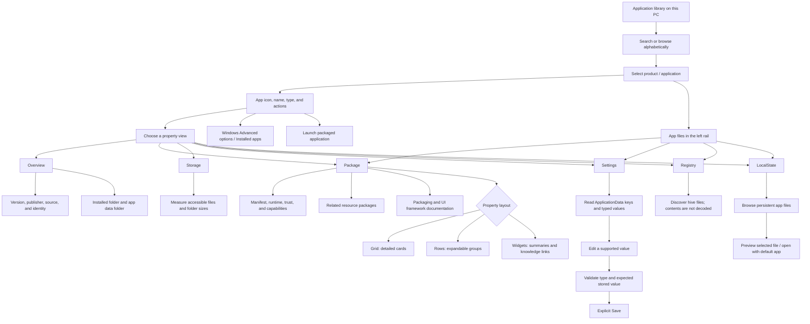

# Application selection and property navigation

Select a product (installed application) in the left rail. Its identity becomes the shared context for the detail views and the file tree beneath its rail entry.

## Navigation and state rules

- The section tabs and Back to top remain above the detail scrolling area. The Grid / Rows / Widgets selector appears above Packaging and UI frameworks in Package view.
- Selecting another application loads its inspection data. Switching a property layout only changes presentation; it must not rescan files or refresh the rail.
- Lists and collections use data-driven layout templates with stable identity keys. The app rail keys each item by its application identity; files use their full paths.
- Conditional true/false layouts belong in the layout template. Use `.Set()` for native properties and behavior, rather than constructing or replacing child layouts.
- Interactive controls have descriptive AutomationName labels. Unrelated updates preserve focus, draft values, expansion state, and mounted controls.
- Motion stays scoped to the component being changed and follows Windows animation preferences.
- Settings writes occur only through explicit Save. Package metadata, manifest declarations, and file previews are read only. Opening Windows Settings or an external app delegates subsequent actions to that application.

Desktop entries without package identity may have fewer available details. MSIX packaging and UI frameworks are separate concepts; manifest data does not always identify the UI framework.

Documentation links, authored property explanations, and layout labels/icons are configured in [UI resources](ui-resources.md). The future optional assistance idea is recorded in [future settings assistance](future-settings-assistance.md).
