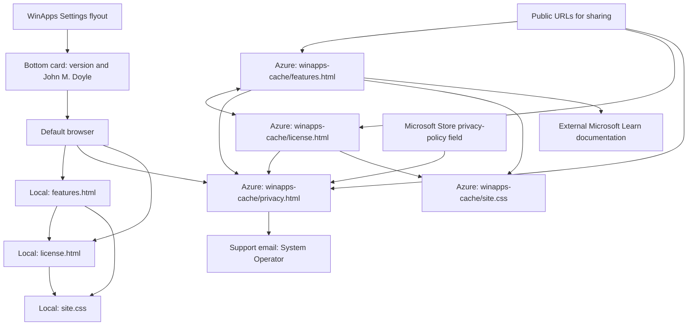

# WinApps public pages

The bottom card in Settings shows the running version and John M. Doyle. Features and License open bundled HTML files in the default browser for offline use; Privacy opens the public Azure policy. These public copies can also be shared:

| Link | Public URL |
| --- | --- |
| Features and getting started | https://webdivelinkscapebrowsers.blob.core.windows.net/linkwebdivebrowsers/winapps-cache/features.html |
| Privacy policy | https://webdivelinkscapebrowsers.blob.core.windows.net/linkwebdivebrowsers/winapps-cache/privacy.html |
| GPL-3.0-only license | https://webdivelinkscapebrowsers.blob.core.windows.net/linkwebdivebrowsers/winapps-cache/license.html |

The Azure links need internet access. All four source files are bundled with builds; keep them beside the executable when sharing a portable build so the local pages retain their styling and navigation.

## Azure upload layout

Upload the four repository-root files together to the existing `linkwebdivebrowsers` container, under `winapps-cache/`. Keep these lowercase names:

```text
linkwebdivebrowsers/                 container
└── winapps-cache/                  blob prefix (folder)
    ├── features.html               features and onboarding
    ├── privacy.html                standalone privacy policy
    ├── license.html                full GPLv3 license
    └── site.css                    features/license styling
```

Set HTML Content-Type to `text/html; charset=utf-8` and CSS Content-Type to `text/css; charset=utf-8`. The URLs must be readable without login or an expiring access token. Features and License use relative links; keeping all four files together preserves navigation and styling. Privacy embeds its styling and links to the System Operator by email.

Use the public Privacy URL for the Microsoft Store privacy-policy field. Features can be the product website. Store screenshots remain images of the actual application; these HTML files are information pages.

## Navigation diagram



Uploading pages is separate from pushing source code to GitHub. After upload, open each public URL and follow its links to verify the deployed files. Changes to the Azure folder or host require updating `SettingsFlyout.PagesUrl` and this document.

Support: [System Operator](mailto:dbadmin@fizzledbydizzlelive.onmicrosoft.com).

Azure reference: [Host a static website in Azure Storage](https://learn.microsoft.com/azure/storage/blobs/storage-blob-static-website-how-to).
